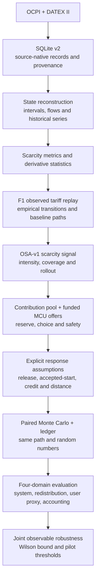

# MATEMAFIJA — Vilnius EV Charging Policy Lab

**A policy stress-testing digital twin for Vilnius EV charging infrastructure.**

MATEMAFIJA turns public OCPI and DATEX II observations into an auditable model
of charging-capacity availability. It replays the observed tariff and tests a
balanced contribution-to-credit policy: qualified scarcity can create a bounded
signal, while already funded mobility-credit units (MCU) support safer
alternative-site choices. The result is a joint robustness map and a measurable
pilot design—not a claim that an untested policy is already proven to work.

Built for **Hack4Vilnius, Challenge 13**.

## What the project answers

The decision question is:

> Under which declared price, credit, delay and spatial-choice response
> assumptions can a budget-constrained contribution-to-credit policy improve
> observable charging scarcity without suppressing accepted use, transferring
> scarcity to receiver sites or breaking access and accounting safeguards?

The current public feeds do **not** observe a physical queue, individual waiting
time, charge-completion time, or post-charge idle time. The project therefore
uses qualified zero availability and related capacity measures as scarcity
evidence, while preserving the distinction between:

- `observed` source facts;
- `reconstructed` state and scarcity variables;
- `estimated` baseline transition rates;
- `policy_defined` pricing rules;
- `assumed` behavioural response parameters;
- `simulated` counterfactual outcomes.

## Architecture



### Policy and response model

- **F1** replays the component-structured tariff supplied through OCPI.
- **OSA-v1** is a bounded TIME-component adjustment driven only by qualified,
  sustained observable capacity pressure.
- **MCU circulation** converts prior simulated funding into bounded alternative-
  site offers; offer, reservation, issuance and redemption remain distinct.
- `lambda` controls adjustment intensity; coverage and rollout are separate.
- Release, accepted-start and receiver-choice sensitivities are scenario
  assumptions, not learned Vilnius elasticities.
- Fixed and adaptive arms use the same baseline path, eligibility mask, random
  numbers and evaluation metrics.
- Joint success requires system, redistribution, observable user-proxy and
  accounting gates; missing evidence is `not_evaluable`, never success.

MCU is a simulated policy accounting unit. It is not legal tender, a deployed
cashback balance or DAEI. DAEI is documented only as Lithuanian precedent and a
possible future integration path.

The simulator exposes three deliberately separate modes:
`observed_replay`, `assumption_driven_counterfactual`, and the future
`validated_counterfactual` mode. Current policy-effect results belong only to
the assumption-driven mode.

## Current readiness

Collection started on 6 October 2026. The repository contains the full
pipeline, policies, simulator contracts, evaluation and interfaces, while the
local database itself remains untracked. At the guide snapshot on 10 October
2026, it contained roughly 2.84 million status observations across 1,984 current
OCPI location records, but only about 4.08 days of history. These are provider
records, not a count of unique physical stations.

The formal transition-model gate requires at least seven qualified local days.
Until that gate passes, the Policy Lab locks the formal effectiveness heatmap.
It may still show a permanently labelled illustrative response surface so the
mechanism can be demonstrated; that preview is assumption-driven, not evidence
and not a forecast. Always recompute readiness before a presentation because
the collector continues to extend the window.

## Quick start

Requirements: Python 3.10+ and network access to the public OCPI/DATEX feeds.

```bash
python -m venv .venv
source .venv/bin/activate
python -m pip install -r requirements.txt
```

Collect one snapshot and initialize `data/ev_charging.db`:

```bash
python src/collect.py --once
```

Continue collection at the default five-minute cadence:

```bash
python src/collect.py
```

Open the jury-facing Policy Lab:

```bash
python -m streamlit run src/policy_dashboard.py
```

Open the source-data and provenance explorer:

```bash
python -m streamlit run src/dashboard.py
```

Or run collection and the data explorer together:

```bash
python src/collect.py --dashboard
```

## Interfaces

### Policy Lab

`src/policy_dashboard.py` presents the competition story in six tabs:

1. **Evidence** — observed coverage, station map, tariffs and readiness;
2. **Policy** — scarcity contribution, MCU pool and funded alternatives;
3. **Response** — explicit release, start and receiver-choice assumptions;
4. **Evaluation** — system, redistribution, user-proxy and accounting domains;
5. **Robustness** — conjunctive gates, missingness and Wilson-bound decision;
6. **Decision** — claim-safe pilot narrative and DAEI separation.

### Data explorer

`src/dashboard.py` reads SQLite in read-only mode and exposes source records,
history, revisions, mappings, quality issues and schema. It deliberately does
not invent queues, idle time, congestion scores or causal effects.

## Documentation

- [Full project and presentation guide (English)](output/pdf/matemafija_project_guide_en.pdf)
- [Full project and presentation guide (Russian)](output/pdf/matemafija_project_guide.pdf)
- [Final five-minute speech and production notes (English)](output/pdf/matemafija_five_minute_speech.pdf)
- [Documentation map](docs/README.md)
- [Three-minute pitch and demo sequence](docs/pitch_narrative.md)
- [Variable and provenance contract](docs/variable_dictionary.md)
- [Common simulator contract](docs/simulator_contract.md)
- [Data and modelling assumptions](docs/assumptions.md)
- [Final acceptance audit](docs/final_acceptance_audit.md)

The English guide is the primary jury-facing description of the same architecture.
The Markdown documents are the normative technical specifications.

The public entry point, technical contracts, primary guide and pitch are in
English for an international Hack4Vilnius audience. The Russian guide and its
supplementary model explainer remain public reference material and are explicitly
labelled in the documentation map; they are not private team notes.

## Repository map

```text
src/        collection, storage, reconstruction, policy and simulation modules
docs/       formal contracts, assumptions, guide and final speech sources
tests/      automated unit and contract tests
data/       local database location; large collected data are not committed
notebooks/  exploratory analysis
output/pdf/ generated public guide and five-minute speech
```

## Verification

Run the complete test suite:

```bash
python -m unittest discover -s tests -v
```

The current suite contains 156 tests covering persistence, timestamp handling,
state reconstruction, scarcity, tariffs, policies, trajectories, response
channels, MCU lifecycle and ledger reconciliation, paired credit simulation,
four-domain evaluation, joint robustness and Policy Lab logic.

## Claim boundary

The defensible result is conditional:

> Under declared response assumptions, the model identifies the parameter
> region where the contribution-to-credit policy is robust within the current
> observable system, redistribution, user-proxy and accounting boundaries.

It does not prove queue reduction, waiting-time reduction, individual welfare,
demographic fairness or a causal real-world effect. `pilot_ready` remains false.
Those claims require a controlled pilot, Session/CDR and route/user evidence,
operator agreements and a validated behavioural model.

The repository has passed its documented public-demo acceptance audit. This
means that the implementation, contracts, interface and claim language agree;
it does not promote a scenario-conditional result to real-world validation.

## Data and security

The repository contains no authentication tokens or local database. Collector
storage sanitizes OCPI credentials metadata, and source mappings retain explicit
provenance and confidence. See [data/README.md](data/README.md) before publishing
or sharing a collected database.

## License

The software in this repository is available under the
[MIT License](LICENSE). Copyright (c) 2026 MATEMAFIJA team.
