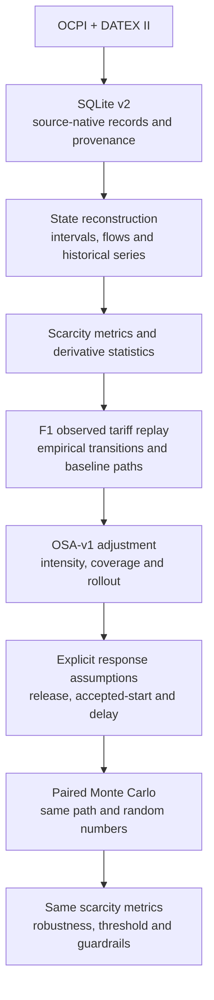

# MATEMAFIJA — Vilnius EV Charging Policy Lab

**A policy stress-testing digital twin for Vilnius EV charging infrastructure.**

MATEMAFIJA turns public OCPI and DATEX II observations into an auditable model
of charging-capacity availability. It replays the observed tariff, applies a
small and transparent adaptive adjustment, and tests the policy across explicit
behavioural assumptions. The result is a robustness map and a measurable pilot
threshold—not a claim that an untested price is already proven to work.

Built for **Hack4Vilnius, Challenge 13**.

## What the project answers

The decision question is:

> How strong would the user response to adaptive pricing need to be before the
> policy robustly improves observable charging-capacity scarcity, and what
> access or spatial trade-offs could offset that benefit?

The current public feeds do **not** observe a physical queue, individual waiting
time, charge-completion time, or post-charge idle time. The project therefore
uses qualified zero availability and related capacity measures as scarcity
evidence, while preserving the distinction between:

- `observed` source facts;
- `reconstructed` state and scarcity variables;
- `estimated` baseline transition rates;
- `policy_defined` pricing rules;
- `assumed` behavioural response parameters;
- `simulated` counterfactual outcomes.

## Architecture



### Pricing and response model

- **F1** replays the component-structured tariff supplied through OCPI.
- **OSA-v1** is a bounded TIME-component adjustment driven only by qualified,
  sustained observable capacity pressure.
- `lambda` controls adjustment intensity; coverage and rollout are separate.
- The release and accepted-start channels are scenario assumptions, not learned
  Vilnius elasticities.
- Fixed and adaptive arms use the same baseline path, eligibility mask, random
  numbers and evaluation metrics.

The simulator exposes three deliberately separate modes:
`observed_replay`, `assumption_driven_counterfactual`, and the future
`validated_counterfactual` mode. Current policy-effect results belong only to
the assumption-driven mode.

## Current readiness

Collection started on 6 October 2026. The repository contains the full
pipeline, policies, simulator contracts, evaluation and interfaces, while the
local database itself remains untracked. At the guide snapshot on 8 October
2026, it contained roughly 1.92 million status observations across 1,984 current
OCPI locations, but only about 2.2 days of history.

The formal transition-model gate requires at least seven qualified local days.
Until that gate passes, the Policy Lab intentionally locks the effectiveness
heatmap. This is a data-readiness guardrail, not a negative result about the
policy. Always recompute readiness before a presentation because the collector
continues to extend the window.

## Quick start

Requirements: Python 3.10+ and network access to the public OCPI/DATEX feeds.

```bash
python -m venv .venv
source .venv/bin/activate
python -m pip install -r requirements.txt
```

Collect one snapshot and initialize `data/ev_charging.db`:

```bash
python src/collect.py --once
```

Continue collection at the default five-minute cadence:

```bash
python src/collect.py
```

Open the jury-facing Policy Lab:

```bash
python -m streamlit run src/policy_dashboard.py
```

Open the source-data and provenance explorer:

```bash
python -m streamlit run src/dashboard.py
```

Or run collection and the data explorer together:

```bash
python src/collect.py --dashboard
```

## Interfaces

### Policy Lab

`src/policy_dashboard.py` presents the competition story in four tabs:

1. **Evidence** — observed coverage, station map, tariffs and readiness;
2. **Mechanism** — OSA-v1 and explicit response assumptions;
3. **Robustness** — conditional effectiveness and minimum response threshold;
4. **Decision narrative** — claim-safe interpretation and pilot proposal.

### Data explorer

`src/dashboard.py` reads SQLite in read-only mode and exposes source records,
history, revisions, mappings, quality issues and schema. It deliberately does
not invent queues, idle time, congestion scores or causal effects.

## Documentation

- [Full project and presentation guide](output/pdf/matemafija_project_guide.pdf)
- [Documentation map](docs/README.md)
- [Three-minute pitch and demo sequence](docs/pitch_narrative.md)
- [Variable and provenance contract](docs/variable_dictionary.md)
- [Common simulator contract](docs/simulator_contract.md)
- [Data and modelling assumptions](docs/assumptions.md)

The guide is the concise, jury-facing description of the same architecture.
The Markdown documents are the normative technical specifications.

## Repository map

```text
src/        collection, storage, reconstruction, policy and simulation modules
docs/       formal contracts, assumptions, guide source and pitch narrative
tests/      automated unit and contract tests
data/       local database location; large collected data are not committed
notebooks/  exploratory analysis
output/pdf/ generated public project guide
```

## Verification

Run the complete test suite:

```bash
python -m unittest discover -s tests -v
```

The current suite contains 100 tests covering persistence, timestamp handling,
state reconstruction, scarcity, tariffs, policies, trajectories, response
channels, paired simulation, robustness, redistribution and Policy Lab logic.

## Claim boundary

The defensible result is conditional:

> Under declared response assumptions, the model identifies the parameter
> region where adaptive pricing robustly improves observable scarcity.

It does not prove queue reduction, waiting-time reduction, welfare improvement
or a causal real-world effect. Those claims require a controlled pilot or a
validated behavioural model. The recommended next step is continued collection
followed by a bounded, instrumented rollout with Session/CDR evidence.

## Data and security

The repository contains no authentication tokens or local database. Collector
storage sanitizes OCPI credentials metadata, and source mappings retain explicit
provenance and confidence. See [data/README.md](data/README.md) before publishing
or sharing a collected database.

## License

No open-source license has been selected yet. Public visibility alone does not
grant reuse rights; the repository owner should add the chosen license before
inviting external reuse or contributions.
